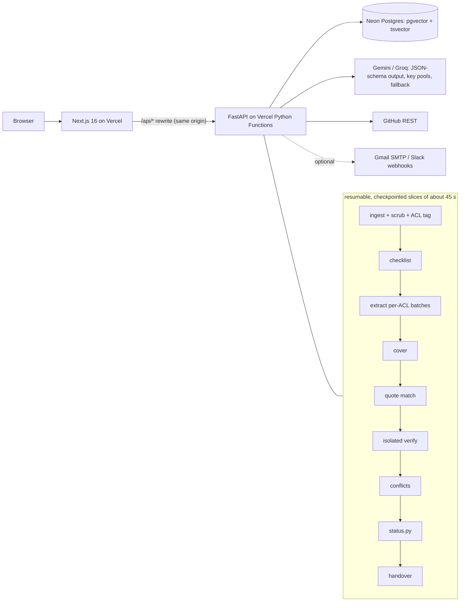

# HANDBACK — Baton Round 2

Written by Claude Code at feature freeze, 10 Nov 2026 (~00:30 IST). Everything here was checked against the running
production system or the test suite; where something does not work or was not done, it says so.

## 1. Links
- Live app: https://baton-lac.vercel.app   (demo path: **Try the demo**, no sign-up)
- Repo: https://github.com/theseriouscoder123/CodersPune   (public: **yes**, checked unauthenticated)
- API health: https://baton-lac.vercel.app/api/health
- API (direct): https://baton-api-peach.vercel.app (the web app proxies `/api/*` to it, so the browser sees one origin)

## 2. Final judge tour
Exact path that works on production (the e2e test drives the same path):

1. Landing → **Try the demo**. Opens the visitor's own sandbox on **Connect**: 4 sources (GitHub repo, meeting notes, `#dev`, `#core-team`). `#core-team` is labelled visible to reviewers, Kabir and Rohan, and the page shows "2 secrets removed in total". A **Demo tour** checklist (bottom right) tracks the six steps.
2. **Reconstruct:** counts by status (demo: 0 verified, 58 supported, 4 inferred, 2 conflicting, 4 missing; 68 live claims), counts by type, decision timeline (the Supabase → Firebase Auth reversal shows as superseded), "How this ledger was built" run log.
3. **Verify** (as Meera, reviewer):
   - Open the FCM claim (G1): evidence from PR #88 highlighted, "Why supported: Quote found in PR #88 (match 100) · verifier: supports". Confirm → Verified.
   - **Conflicts** tab: G3 (5 MB in notes vs 2 MB in `upload.ts:41`). Pick one or keep both as an open risk.
   - **Missing** tab: G5 and G14 plus two more checklist items. Copy questions for the leaver (Markdown, GitHub issue, or email if configured).
4. **Review** (`Preview what Neha will see`): 54 items shared, 10 withheld with the reason "cites #core-team" (the sponsor deal G8 among them), and 4 inferred claims not shared. Approve v1; the dialog warns about unresolved conflicts and unreviewed claims first.
5. **Handover:**
   - Persona switcher → **Neha**: Start here (G12, G4 …), Who owns what (G2), Key decisions (G1, G7), Risks and conflicts (G3, G13, G10), Dependencies, **Unresolved** (G5, G14 …).
   - No TechNova or ₹40,000 anywhere. Phone numbers masked.
   - Any source ref opens the evidence drawer.
   - **Ask the handover** answers with numbered citations to approved items.

Differences from docs/04 §6:
- The steps are pages in a stepper (Connect / Reconstruct / Verify / Review / Handover), not tabs on one screen.
- G6 (leaderboard) is phrased "on hold / empty skeleton behind a flag", so it is Supported rather than Inferred. The spec accepts both.

## 3. Feature status
| Feature (Round 1 plan name) | Status | Notes (what works, limits) |
|---|---|---|
| Source connectors | **done** | GitHub public, or private via a read-only token used once and never stored (README/docs, commits + per-file commit stats, PRs, issues, review comments, CODEOWNERS, CI workflows, `.env.example`, manifests). Notes: Markdown, text, PDF and **Word .docx** (new). Chat: Slack and **Discord** exports. The demo GitHub source is a GitHub-API-shaped synthetic fixture through the same normaliser (D5). |
| Access tagging | **done** | Every source and chunk carries an access list. Default deny. Checked in the server on every read; a claim is visible only if all cited sources are. A 40-endpoint isolation test covers it. |
| Secret scrubbing | **done** | Keys, tokens and passwords replaced before storage and before any model call; per-source scrub report. PII (phones, emails) masked for non-reviewers. |
| Claim extraction | **done** | Typed claims with exact quotes, chunk ids and timestamps via JSON-schema structured output. Batches never mix access groups. One retry on invalid JSON, then the batch fails visibly. |
| Expected-knowledge checklist | **done** | From open PRs/issues by the leaver, env keys, workflows, files mostly maintained by the leaver. Uncovered items become Missing. |
| Verification and status rules | **done** | Quote match (≥ 90) as a hard gate, isolated LLM verifier, five statuses from the pure `status.py`. `VERIFIER=nli` option not used (no RAM on Vercel; D8). |
| Review workspace | **done** | Evidence panel; edit (re-verifies), confirm, reject, promote-with-note; conflict resolution. Versions and approval. New: bulk actions, shortcuts, progress meter, pre-approval warnings, search, activity log, Undo on confirm/reject, auto-advance to the next unreviewed claim, copy-a-link to a claim (D45). |
| Role-filtered handover | **done** | Successor view (Start here, owners, decisions, risks, dependencies, unresolved); Markdown export; print/PDF. New: scoped multiple handovers, version changelog, Ask the handover. |
| Gap interview | **deferred-R3 (#1)** | R2 has the manual precursor: copyable / GitHub-issue / emailable "Questions for the leaver". `sources.type` already allows `testimony`. |
| Conflict and supersession timeline | **partial (R2 basics) / deferred-R3 (#2)** | R2: deterministic conflict detection by value class, reversal language → superseded, read-only decision timeline. R3: interactive timeline and a richer reversal-vs-contradiction model. |
| Acknowledgement and visibility preview | **preview done in R2; acknowledgement deferred-R3 (#3)** | The reviewer's visibility preview (withheld items and why) was pulled into R2 because the core loop needs it. The `acknowledgements` table exists; no UI yet. |
| Auth (R1: login) | **changed** | No OAuth. Persona switcher for the demo, plus per-member private invite links and **locked identities** for real teams (D1, D20). |
| *New:* Re-run modes | done | Refresh keeps all review work; stale evidence follows edited text or flags the claim (D19, D27). |
| *New:* Teams and notifications | done | Invite links, optional Gmail SMTP email and Slack webhooks (off by default; D29), workspace export and delete (D34). |
| *New:* Operations | done | Abuse limits, daily sandbox clean-up cron, pipeline-health page, AI key pools with Gemini → Groq fallback (D26), security headers, timeouts, row locks (D24, D28, D35–D39). |
| *New:* Getting-started checklist, accessibility | done | D30, D33 (axe: 0 WCAG 2.1 AA violations). |

## 4. Planted scenario results (production demo ledger)
| G-id | Produced? | Status shown | Correct? | Note |
|---|---|---|---|---|
| G1 | yes | supported (→ verified on confirm) | yes | FCM replaced OneSignal; cites PR #88 + `notifications.ts` |
| G2 | yes | supported | yes | Rohan 31 of 33 commits on `deploy.yml` (commit-stats chunk) |
| G3 | yes | conflicting | yes | 2 MB (`upload.ts:41`) vs 5 MB (notes 2 Apr) |
| G4 | yes | supported | yes | PR #142 waiting for Dr. Rao |
| G5 | yes | missing | yes | Firebase owner/billing unknown (checklist) |
| G6 | yes | supported | yes (status) / citation miss | "Empty skeleton behind a feature flag" cites PR #126, not the issue #120 comment the golden ledger expects |
| G7 | yes | supported; Jan Supabase claim superseded | yes | Not flagged as a conflict |
| G8 | yes | supported, **withheld from Neha** | yes | Visible to Meera, Rohan and Kabir only |
| G9 | n/a (no claim) | 2 redactions | yes | Neither fake key exists anywhere in the DB |
| G10 | yes | supported | yes | Recurring Wi-Fi upload timeouts; compress client-side |
| G11 | yes | supported | yes | Cloudinary |
| G12 | yes | supported | yes | Vercel transfer to Neha before 15 Nov |
| G13 | yes | supported | yes | No tests for the RSVP flow |
| G14 | yes | missing | yes | Issue #131 status unknown |
| G15 | n/a (no claim) | phone masked | yes | Masked for everyone except the reviewer |

Eval totals: claim recall 13/13, status accuracy 13/13, citation precision 9/10, permission leaks 0, secret leaks 0.

## 5. Stack, services and disclosures (with versions and licences)
**Backend (Python 3.12):**

| Library | Version | Licence |
|---|---|---|
| FastAPI | 0.162.2 | MIT |
| Pydantic | 2.14.3 | MIT |
| pydantic-settings | 2.16.2 | MIT |
| SQLAlchemy | 2.1.8 | MIT |
| Alembic | 1.20.1 | MIT |
| psycopg | 3.3.8 | LGPL-3.0 |
| pgvector (Python) | 0.5.1 | MIT |
| httpx | 0.28.1 | BSD-3 |
| rapidfuzz | 3.14.6 | MIT |
| pypdf | 7.0.0 | BSD-3 |
| python-multipart | 0.0.33 | Apache-2.0 |
| uvicorn (local dev) | 0.54.0 | BSD-3 |

**Dev tooling:** pytest (MIT), ruff (MIT), uv (MIT/Apache-2.0).

**Frontend:**

| Library | Version | Licence |
|---|---|---|
| Next.js | 16.4.5 | MIT |
| React / React DOM | 19.3.0 | MIT |
| Tailwind CSS | 4.3.5 | MIT |
| TypeScript | 5 | Apache-2.0 |
| lucide-react | 0.460.0 | ISC |
| ESLint + eslint-config-next | 9 / 16.4.5 | MIT |
| Playwright | 1.56.1 | Apache-2.0 |
| @axe-core/playwright | 4.10.2 | MPL-2.0 |

**Fonts:** Fraunces, Geist, Geist Mono (SIL OFL).

**AI models:**

| Provider | Model id | Purpose |
|---|---|---|
| Google Gemini API | `gemini-3.5-flash` | Extraction (demo ledger) |
| Google Gemini API | `gemini-3.5-flash-lite` | Isolated verification, checklist coverage, Ask |
| Google Gemini API | `gemini-3.1-flash-lite` | Fallback |
| Groq | `openai/gpt-oss-120b`, `openai/gpt-oss-20b` | Fallbacks for extraction (120b) and verification/Ask (20b); not used for the demo ledger |

Calls are REST with JSON-schema output (no SDK). Production holds key pools of 3 Gemini and 2 Groq keys. Calls rotate across keys and fall back across providers (D26).

Production chains:
- Extraction: `gemini-3.5-flash` → `gpt-oss-120b` → `gemini-3.1-flash-lite` → `gemini-3.5-flash-lite`.
- Verification/Ask: `gemini-3.5-flash-lite` → `gpt-oss-20b` → `gemini-3.1-flash-lite` → `gpt-oss-120b`.

All five keys were checked live on 10 Nov, including structured extraction on both Groq models with verbatim quotes.

**External services:**
- Vercel: two projects, Hobby plan; Next.js + Python Functions, with a daily cron.
- Neon Postgres: free plan, pooled endpoint, pgvector, full-text search.
- GitHub REST API (read-only token).
- Optional: Gmail SMTP, Slack incoming webhooks.

**Datasets:** synthetic "Campus Events App" dataset written for this project (`demo/`: GitHub-shaped fixture, meeting notes,
Slack export, `golden_ledger.json`). Public repos used during testing: `pallets/itsdangerous`, `pallets/markupsafe` (D17).

**Templates and generators:** `create-next-app` for `apps/web`. No UI kit or template (shadcn/ui was allowed but not used).

**AI coding assistance:** Claude Code (Anthropic) wrote most of the code under Arch's direction.

## 6. Architecture as built

Differences from docs/02:
- Hosting is Vercel + Neon, with no Docker in production (D8).
- The pipeline is advanced by the run page's polling (`POST /runs/{id}/advance`) instead of background workers.
- The demo template is seeded from a frozen, eval-checked ledger (D15) and cloned per visitor (~1 s).
- Added tables: `llm_calls`, `member_invites`, `member_bindings`, `notifications` (migrations 0002–0005).
- Added row locks, per-transaction timeouts and hot-path indexes.

## 7. Testing
- **Unit and integration:** 173 passed, 0 failed (`apps/api/tests`, real Postgres). They cover:
  - the trust core (status, quote match, scrubber, ACL, reconstruction rules);
  - end-to-end permissions, a 40-endpoint isolation sweep and concurrency;
  - the pipeline, re-runs and stale evidence;
  - LLM routing and prompt safety;
  - limits, security headers and notifications.
- **Eval, four runs:**
  - Production demo ledger (Gemini 3.5 Flash): recall 13/13, status accuracy 13/13, citation precision 9/10.
  - Three live runs on 10 Nov, with extraction on Groq `gpt-oss-120b` because Gemini was over quota or returning 503s: recall 9/13, 9/13 and 10/13. Status accuracy always equalled recall, so no produced claim was mis-graded.
  - Misses trace to extraction batches that failed on Groq's per-minute limit. A retry added during testing raised recall from 9 to 10.
  - **0 permission leaks and 0 secret leaks in all four runs.**
  - Details: `docs/TESTING.md` §2.
- **Custom repos on production:** `pallets/markupsafe` (75 claims) and `sindresorhus/slugify` with a Word note (85 claims) both completed. The slugify run first exposed a Unicode bug in the quote matcher, which was fixed, and the run was then resumed from the failed step.
- **Security assessment:** every real secret value was searched in git history, the tree, the web bundle and 25 live production responses: 0 leaks. Planted-secret tests cover the error paths (D40).
- **Cold start:** demo ready in 4.7 s on a fast network and 3.4 s on slow 3G; claims list in 3.0 s.
- **E2E:** Playwright against production, **13/13 passed** on 10 Nov 2026: judge flow, search, checklist, phone layout, plus axe accessibility audits with 0 violations.
- **Known failures:** none open. One e2e run right after a deploy stalled on a page whose scripts didn't load; a re-run passed (see §9).

Full details: `docs/TESTING.md`.

## 8. Changes from the Round 1 plan
Full list in `docs/DECISIONS.md` (D1–D45). The main ones:
- **Hosting:** free-tier Vercel + Neon with a resumable pipeline (D8).
- **No login:** persona switcher, then invite links and locked identities (D1, D20).
- **LLM:** Gemini with fallback chains, key pools and Groq (D11, D16, D26).
- **Demo:** a frozen, precomputed demo ledger (D15).
- **Earlier than planned:** the visibility preview, built in R2.
- **Added beyond the plan:** Ask, scoped handovers, re-run modes, stale-evidence handling, search, activity log, changelog, notifications, export/delete, accessibility and hardening (D19–D45).

## 9. Known issues and limitations (honest)
- **Live AI depends on free quotas.** These are now spread over 3 Gemini and 2 Groq keys with automatic fallback, which is much more headroom, but still finite. The precomputed demo never needs the AI.
- **Extraction quality depends on the model.** With Gemini over quota or overloaded, Groq-based runs found 9–10 of 13 planted claims instead of 13. Safety held in every run. The demo ledger is precomputed with Gemini.
- **A deploy drops in-flight requests**, for example a running pipeline slice. Runs resume on the next poll, but deploys should be avoided while judges are on the site.
- **Ask quality varies with the model.** It sometimes calls a well-covered question "partial", for example "Why did we leave OneSignal?", because the ledger states the move but not every reason.
- **Email and Slack are untested against real services.** They are built and tested with fake transports only. They stay off until SMTP settings or a webhook are added.
- **Deploy-moment glitch:** a page loaded during a deploy can stall while old and new assets mix. Mitigations: a CSS-only "Reload" hint after 8 s, and no deploys while judges are on the site.
- **One unexplained 58 s request** was seen on production. It wasn't reproducible, and the free plan kept no logs. Timeouts and a client retry now bound it.
- **Private repos can't be refreshed automatically**, because their token is never stored.
- **Large custom repos** read at most about 60k characters of history per run, prioritised (D17). Very old history may be skipped; the UI says so.
- **Secrets pasted during development:** Arch should rotate the Neon password, all 3 Gemini keys, both Groq keys and the GitHub token after the hackathon.

## 10. Round 3 readiness
| Improvement | Seams already in place | Rough effort |
|---|---|---|
| #1 Gap interview with cited testimony | `sources.type` allows `testimony`. Questions are generated per claim and are already permission-filtered for the leaver (the email path). A notification channel exists. | 1.5–2 days: answer form/link for the leaver, testimony source + chunks, re-run status for answered claims |
| #2 Conflict and supersession timeline | `claims.superseded_by`, `subject_key`, `conflict_groups` with resolution; the timeline endpoint exists; deterministic reversal and historical rules. | 1.5 days: interactive timeline UI, explicit "reversed vs contradicts" classification with evidence for each |
| #3 Acknowledgement and visibility diff with re-rendering | The `acknowledgements` table exists. Per-viewer projection and the version changelog exist. The visibility preview is done. | 2 days: per-item acknowledge/track to closure, and re-rendering withheld claims from accessible sources only (needs a constrained re-extraction per viewer) |

## 11. Commit-history facts
- First commit: **2026-11-08 16:40:42 +05:30** (`ea1e64d`, planning docs and repo basics), after the window opened (Sun 8 Nov 2026 10:00 IST).
- Commits at freeze: 69 (including this handback refresh); see `git log`. History is never squashed. Each states what changed; AI-assisted commits carry a Claude co-author line.
- No code written before the build window was imported. The planning documents in `docs/` (written before the window) are not code.
