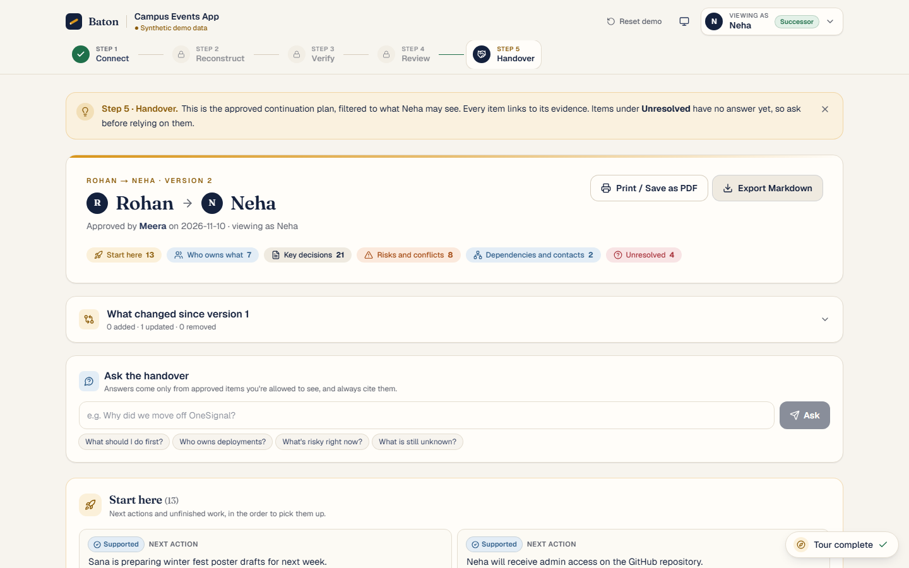

# Baton

**An evidence-graded knowledge handover for small software teams.**
When someone leaves a project, Baton reads what they left behind (repo, notes, chat) and rebuilds what they knew as a
ledger of claims. Every claim links to the exact quote it came from and gets a status from deterministic rules, not from
the AI. A reviewer checks and approves it, and the successor gets a continuation plan filtered to what they're allowed to
see, with the unknowns clearly marked.

> CodersInPune Hackathon · Round 2 (The Build) · Team LoneWolf (Archit Dandavate)

- **Live app:** https://baton-lac.vercel.app  (click **Try the demo**, no sign-up)
- **API health:** https://baton-lac.vercel.app/api/health
- **Repo:** https://github.com/theseriouscoder123/CodersPune



## 60-second tour

1. Click **Try the demo**. You get your own copy of a fictional student-club project ("Campus Events App"), so nothing you do affects anyone else. A **Demo tour** checklist in the corner tracks the six steps and takes you to the next one.
2. **Connect:** 4 sources and who can read each. `#core-team` is restricted, and 2 planted fake secrets were removed before storage.
3. **Reconstruct:** the ledger with counts by status, and a decision timeline in which a reversed decision shows as superseded, not as a contradiction.
4. **Verify:** open any claim to see the exact quote highlighted in its source and *why* it got its status. Confirm, edit, reject or promote it. Resolve the 5 MB vs 2 MB conflict. The **Missing** tab turns unknowns into questions for the leaver (copy, GitHub issue, or email).
5. **Review:** preview exactly what Neha (the successor) will see. The sponsor deal from `#core-team` is withheld, with the reason. Approve v1.
6. **Handover:** switch to **Neha** (top right). Her plan has Start here, owners, decisions, risks, dependencies and **Unresolved**. Every item opens its evidence. You can also **ask the handover** a question and get an answer that cites approved items only.

## The trust rules, and where they're enforced

| Rule | How |
|---|---|
| Statuses come from rules, not the AI | `apps/api/baton/status.py` is a pure function of evidence and review state. The model's output schema has no status field. |
| No fabricated quotes | Every quote must be found in its cited chunk (normalised fuzzy match ≥ 90, `verify/quote_match.py`), or the claim can't be Supported |
| The generator never grades itself | Verification is a separate, isolated call that sees only the claim and the quoted span |
| Inferred claims are never shown as fact | Hidden from the successor unless a reviewer promotes them with a note, then labelled "Reviewer-confirmed (no source evidence)" |
| Permissions are enforced on the server, at every read | A claim is visible only if *every* source it cites is visible (`acl.py`). Tested by a 40-endpoint isolation sweep. Ask, search, the changelog and notifications all go through the same projection. |
| Extraction never mixes access groups | Chunks are batched by identical access list |
| Secrets are scrubbed first | Before storage and before any model call. Personal phone numbers and emails are masked for non-reviewers. |
| Nothing reaches the successor before approval | The successor sees approved versions only, including evidence |
| Synthetic demo data | Labelled in the UI |

## Features

- **Connect:**
  - Sources: public or private GitHub repos (the token is used once and never stored), Markdown/text/PDF/Word notes, and Slack or Discord exports.
  - Every source carries an access list.
- **Reconstruct:**
  - Typed claims with exact quotes, plus a checklist of what the repo says *should* be known (uncovered items become Missing).
  - Conflict and reversal detection, and a decision timeline.
  - Re-runs: **Refresh** reads only new activity and keeps all review work. If a source changes, evidence follows its quote, or the claim is flagged "source changed".
- **Verify and review:**
  - Evidence panel with highlighted quotes; edit / confirm / reject / promote.
  - Bulk actions, keyboard shortcuts (j/k/c/r/e/x), a progress meter and warnings before approving.
  - Ctrl+K search over claims and sources; an activity log with CSV export.
- **Handover:**
  - Visibility preview, versioned approvals, and a "what changed since vN" changelog.
  - Several scoped handovers per project.
  - Print / PDF and Markdown export; Ask the handover (cited answers only).
- **Teams:**
  - Private invite links per person, and locked identities, so nobody can view the workspace as someone else.
  - Optional email (Gmail SMTP) and Slack notifications.
  - Workspace JSON export and deletion.
- **Operations:**
  - Abuse limits and daily clean-up of old demo copies; a pipeline-health page.
  - AI key rotation with provider fallback (Gemini, Groq).
  - Security headers, request ids and timeouts; WCAG 2.1 AA checked.

## Testing

164 API tests, a citation eval against a labelled golden ledger (recall 13/13, status accuracy 13/13, citation
precision 9/10, 0 permission leaks, 0 secret leaks), and 13 Playwright end-to-end and accessibility checks that run
**against production**. Details and reproduction steps: [`docs/TESTING.md`](docs/TESTING.md).

## Local setup

```bash
cp .env.example .env                                   # fill in what you need; every variable is documented
docker compose up -d db                                # Postgres 16 + pgvector on :5433 (or use a Neon dev branch)
cd apps/api && uv sync && uv run alembic upgrade head
cd apps/api && uv run python -m baton.seed_demo --frozen   # demo template from the frozen ledger, no AI key needed
cd apps/api && uv run uvicorn baton.main:app --reload --port 8000
cd apps/web && pnpm install && pnpm dev                # http://localhost:3000
```

Live AI features (custom repos, re-runs, Ask) need `LLM_*` / `GEMINI_API_KEYS` / `GROQ_API_KEYS`. Email and Slack are
optional; the app runs fully without them.

## Architecture

```
Browser ── Next.js 16 (Vercel) ── /api/* rewrite ──► FastAPI (Vercel Python Functions) ──► Neon Postgres (pgvector, FTS)
                                                         │
                                                         ├─ resumable pipeline: ingest → checklist → extract → cover →
                                                         │  match quotes → verify → conflicts → status → handover
                                                         └─ Gemini / Groq (structured JSON output, key pools, fallback)
```

The pipeline runs in bounded, checkpointed slices driven by the run page's polling, so no request nears the serverless
time limit. Hosting is entirely free tier (DECISIONS D8). More detail: [`docs/02_ARCHITECTURE.md`](docs/02_ARCHITECTURE.md),
[`HANDBACK.md`](HANDBACK.md) and every deviation from the Round 1 plan in [`docs/DECISIONS.md`](docs/DECISIONS.md).

## Disclosures

- **AI-assisted:** the code in this repository was written with **Claude Code (Anthropic)** under Archit's direction.
- **Scaffolding:** `apps/web` was generated with `create-next-app` (Next.js, TypeScript, Tailwind CSS, ESLint). No UI
  kit or template; components and visual design were written for this project.
- **Libraries/assets:**
  - icons from `lucide-react` (ISC);
  - fonts Fraunces, Geist and Geist Mono (SIL OFL) via `next/font/google`;
  - testing with Playwright (Apache-2.0) and axe-core (MPL-2.0).
  - Full list with versions in `HANDBACK.md` §5.
- **AI models:** Google Gemini (`gemini-3.5-flash`, `gemini-3.5-flash-lite`, `gemini-3.1-flash-lite`) via the Gemini API, with Groq-hosted `openai/gpt-oss-120b` and `openai/gpt-oss-20b` as fallbacks.
- **Services:** Vercel (hosting), Neon (Postgres), GitHub REST API; Gmail SMTP and Slack webhooks only if configured.
- **Data:** all demo data is **synthetic**, written for this project. No real club or workplace data is used.
- **Build window:** no code was written before the official build window (opened Sun 8 Nov 2026, 10:00 IST). Planning documents in `docs/` predate the code, which the rules permit.
