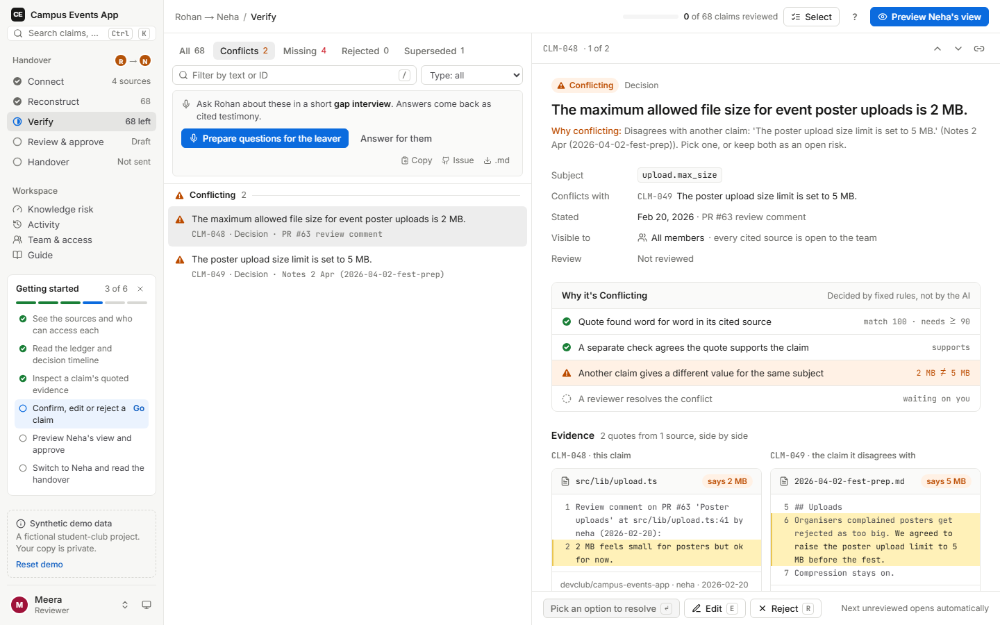

# Baton

**An evidence-graded knowledge handover for small software teams.**
When someone leaves a project, Baton reads what they left behind (repo, notes, chat) and rebuilds what they knew as a
ledger of claims. Every claim links to the exact quote it came from and gets a status from deterministic rules, not from
the AI. A reviewer checks and approves it, and the successor gets a continuation plan filtered to what they're allowed to
see, with the unknowns clearly marked.

> CodersInPune Hackathon · Round 3 (The Finish) · Team LoneWolf (Archit Dandavate)

- **Demo access: no login or credentials needed.** Open the live app, click **Try the demo** (you get your own private
  copy), then use the person switcher at the bottom of the sidebar to act as Meera (reviewer), Neha (successor) or
  anyone else on the team. Each person sees only what their access allows, enforced by the server.
- **Live app:** https://baton-lac.vercel.app
- **Guide:** https://baton-lac.vercel.app/guide (workflow, statuses, access rules and limits)
- **API health:** https://baton-lac.vercel.app/api/health
- **Repo:** https://github.com/theseriouscoder123/CodersPune



## 60-second tour

The demo is a fictional student-club project. Meera reviews, Rohan is leaving, Neha takes over. Switch person with the switcher at the bottom of the sidebar (in the menu on a phone). The sidebar walks the five steps with live counts.

1. Click **Try the demo**. You get your own copy of a fictional student-club project ("Campus Events App"), so nothing you do affects anyone else. A **Getting started** box in the sidebar tracks six steps and takes you to the next one.
2. **Connect:** 4 sources and who can read each. `#core-team` is restricted, and 2 planted fake secrets were removed before storage.
3. **Reconstruct:** the ledger with counts by status and type, and a decision timeline that tells a changed decision apart from a contradiction.
4. **Verify:** open any claim to see the rule checks behind its status and the exact quote highlighted in its source, with line numbers. Confirm, edit, reject or promote it. Resolve the 5 MB vs 2 MB conflict. The **Missing** tab turns unknowns into questions for the leaver (copy, GitHub issue, or email).
5. **Review:** preview exactly what Neha (the successor) will see. The sponsor deal from `#core-team` is withheld, with the reason. Approve v1.
6. **Handover:** switch to **Neha** (bottom of the sidebar). Her plan has Start here, owners, decisions, risks, dependencies and **Unresolved**. Every item opens its evidence. You can also **ask the handover** a question and get an answer that cites approved items only.

**New in Round 3, the three improvements:**
- **Gap interview (#1):** on **Verify** (Missing tab), *Prepare questions for the leaver* builds questions from the Missing and Conflicting items. Switch to **Rohan** to answer them. Each answer becomes a cited **leaver testimony** source that can never be wider in access than the items it answers.
- **Decision timeline (#2):** on **Reconstruct**, the timeline tells a *changed decision* apart from a *contradiction*, shows how a resolved conflict was settled, and labels open work that later events overtook (*Updated later*, *Parked* or *Probably done*). Click a label to see the exact signal, and override it as the reviewer.
- **Acknowledgement and re-rendering (#3):** the preview flags withheld items that look like Neha's own work and offers **Rewrite from Neha's sources**, which rebuilds the item only from sources she can read (precomputed in the demo), **Change access**, or **Write a note** (shared as reviewer-confirmed, never as a sourced fact). The preview can also **compare any two people's views** (Neha vs Kabir shows exactly what #core-team adds). As **Neha**, mark items *Got it*, *Ask a question* or *Not mine*. Meera answers questions in place, and Neha closes them. Responses carry over between versions unless the item changed.

## The trust rules, and where they're enforced

| Rule | How |
|---|---|
| Statuses come from rules, not the AI | `apps/api/baton/status.py` is a pure function of evidence and review state. The model's output schema has no status field. |
| No fabricated quotes | Every quote must be found in its cited chunk (normalised fuzzy match ≥ 90, `verify/quote_match.py`), or the claim can't be Supported |
| The generator never grades itself | Verification is a separate, isolated call that sees only the claim and the quoted span |
| Inferred claims are never shown as fact | Hidden from the successor unless a reviewer promotes them with a note, then labelled "Reviewer-confirmed (no source evidence)" |
| Permissions are enforced on the server, at every read | A claim is visible only if *every* source it cites is visible (`acl.py`). Tested by a 40-endpoint isolation sweep. Ask, search, the changelog and notifications all go through the same projection. |
| Extraction never mixes access groups | Chunks are batched by identical access list |
| Secrets are scrubbed first | Before storage and before any model call. Personal phone numbers and emails are masked for non-reviewers. |
| Nothing reaches the successor before approval | The successor sees approved versions only, including evidence |
| Synthetic demo data | Labelled in the UI |

## Features

- **Connect:**
  - Sources: public or private GitHub repos (the token is used once and never stored), Markdown/text/PDF/Word notes, and Slack or Discord exports.
  - Every source carries an access list.
- **Reconstruct:**
  - Typed claims with exact quotes, plus a checklist of what the repo says *should* be known (uncovered items become Missing).
  - Conflict and reversal detection, and a decision timeline.
  - Re-runs: **Refresh** reads only new activity and keeps all review work. If a source changes, evidence follows its quote, or the claim is flagged "source changed".
- **Verify and review:**
  - Evidence panel with highlighted quotes; edit / confirm / reject / promote.
  - Bulk actions, keyboard shortcuts (j/k/c/r/e/x), a progress meter and warnings before approving.
  - Ctrl+K search over claims and sources; an activity log with CSV export.
- **Handover:**
  - Visibility preview, versioned approvals, and a "what changed since vN" changelog.
  - Several scoped handovers per project.
  - Print / PDF and Markdown export; Ask the handover (cited answers only).
- **Round 3:**
  - Gap interview: questions from Missing and Conflicting items go to the leaver; answers become cited leaver testimony.
  - Decision timeline: changed decision vs contradiction, stale open work, reviewer overrides.
  - Successor acknowledgement with questions tracked to closure, and withheld items re-rendered from the successor's accessible sources only.
  - One handover count on every screen, the admin can change source access, faster pages.
  - **Knowledge risk:** who would take knowledge with them if they left (files only they maintain, open tasks, unanswered gaps), plus services with no named owner, by fixed rules, with "start a handover" from there. Also available as a **GitHub Action** for any repo.
  - **Before the leaver leaves:** a countdown to the leaver's last day and one ordered checklist (their tasks, conflicts only they can settle, unanswered questions, files needing a walkthrough, successor questions).
  - **The successor's first week:** the approved handover arranged into Day 1 / Days 2–3 / rest of week 1, each item with a reason.
  - **Integrations:** live Slack connector (bot token used once; channel membership becomes the access list), Slack and Discord notifications, questions opened as a pre-filled GitHub issue (restricted questions left out), self-hosting with Docker and any OpenAI-compatible model.
  - **Guided access setup** when creating a workspace (who can read what, with warnings and one-click fixes), and runs you can **cancel and resume**, with a plain explanation when the free AI quota stops one.
  - **Redesigned interface** in light and dark: a sidebar with the five steps and live, permission-filtered counts, a two-pane Verify inspector, and the handover as a document. It works on phones. Brief tooltips on the screens; the longer explanations live in the **Guide** (`/guide`).
  - **Robust intake:** a mistyped, private or empty repo is caught on the form before anything is created; empty or binary uploads get a clear message; bot activity and dependency bumps are skipped at ingest.
- **Teams:**
  - Private invite links per person, and locked identities, so nobody can view the workspace as someone else.
  - Optional email (Gmail SMTP), Slack and Discord notifications.
  - Workspace JSON export and deletion.
- **Operations:**
  - Abuse limits and daily clean-up of old demo copies; a pipeline-health page.
  - AI key rotation with provider fallback (Gemini, Groq).
  - Security headers, request ids and timeouts; WCAG 2.1 AA checked.

## Testing

| Measure | Result (15 Nov 2026) |
|---|---|
| API tests | **246 passed**, real Postgres |
| End-to-end and accessibility, **against production** | **22/22** (one spec flaked once under load and passed 6/6 on repeat), including every Round 3 journey and the Guide; axe: 0 serious violations in light and dark; no sideways scroll on phones |
| Live custom repo on production | `kentcdodds/cross-env` + notes through the create form: ledger in about 6 min, **64/64 quotes found and verified**, 0 failed batches (D74, D75) |
| Blind agent tests on production | A first-time judge, a phone user, a permission prober and a UI/UX reviewer (no project context) all finished the loop; their findings are fixed (D69, D71, D73) |
| Citation precision (target ≥ 90%) | **9/10**; claim recall 13/13, status accuracy 13/13 |
| Permission safety (target 0) | **0 leaks** in 179 successor requests across all 29 GET routes |
| Successor readiness (simulated blind testers) | **10/10 in about 14 s with Baton** vs 10/10 in about 37 s from raw sources (12 files) |

Method, limits and reproduction steps: [`docs/TESTING.md`](docs/TESTING.md).

## Local setup

```bash
cp .env.example .env                                   # fill in what you need; every variable is documented
docker compose up -d db                                # Postgres 16 + pgvector on :5433 (or use a Neon dev branch)
cd apps/api && uv sync && uv run alembic upgrade head
cd apps/api && uv run python -m baton.seed_demo --frozen   # demo template from the frozen ledger, no AI key needed
cd apps/api && uv run uvicorn baton.main:app --reload --port 8000
cd apps/web && pnpm install && pnpm dev                # http://localhost:3000
```

Checked from a clean clone on 15 Nov 2026 with no AI key: migrations, demo restore, the API serving a demo copy, and the web build all work.

Live AI features (custom repos, re-runs, Ask, rewriting withheld items) need `LLM_*` / `GEMINI_API_KEYS` /
`GROQ_API_KEYS`. With a key, `uv run python -m baton.seed_rerender` precomputes the demo's rewrites (improvement #3).
Without it, those rewrites are simply absent. Email and Slack are optional; the app runs fully without them.

## Self-hosting (one command)

Handover data is sensitive, so Baton can run entirely inside your network:

```bash
docker compose --profile full up --build      # Postgres + API + web; open http://localhost:3000
```

The demo is seeded from the frozen ledger, so no AI key is needed to try it. For live runs, add a `.env` with
Gemini or Groq keys, **or point Baton at your own model**: any OpenAI-compatible server (OpenAI, Azure OpenAI,
vLLM, LM Studio, a local Ollama) via `OPENAI_BASE_URL`; see `.env.example`. Checked on 14 Nov 2026 from a clean
clone with no `.env`: the stack starts, and the browser judge flow and knowledge-risk tests pass against it (10/10).

## GitHub Action: knowledge risk in any repo

The same rules as the Knowledge risk panel run as a GitHub Action, with no AI and no hosted service. Ownership
comes from `git log`, and open assigned issues and PRs from the workflow's own token. The report goes to the job
summary and a JSON artifact.

```yaml
- uses: actions/checkout@v4
  with: { fetch-depth: 0 }
- uses: theseriouscoder123/CodersPune/.github/actions/knowledge-risk@main
  # with: { since: "2 years ago", fail-on-high: "false" }
```

This repo runs it weekly (`.github/workflows/knowledge-risk.yml`).

## Architecture

```
Browser ── Next.js 16 (Vercel) ── /api/* rewrite ──► FastAPI (Vercel Python Functions) ──► Neon Postgres (pgvector, FTS)
                                                         │
                                                         ├─ resumable pipeline: ingest → checklist → extract → cover →
                                                         │  match quotes → verify → conflicts → status → handover
                                                         └─ Gemini / Groq (structured JSON output, key pools, fallback)
```

The pipeline runs in bounded, checkpointed slices driven by the run page's polling, so no request nears the serverless
time limit. Hosting is entirely free tier (DECISIONS D8). More detail: [`docs/ARCHITECTURE.md`](docs/ARCHITECTURE.md) (as built, Round 3), [`docs/ROADMAP.md`](docs/ROADMAP.md),
[`HANDBACK.md`](HANDBACK.md) and every deviation from the Round 1 plan in [`docs/DECISIONS.md`](docs/DECISIONS.md).

## Disclosures

- **AI-assisted:** the code in this repository was written with **Claude Code (Anthropic)** under Archit's direction.
- **Scaffolding:** `apps/web` was generated with `create-next-app` (Next.js, TypeScript, Tailwind CSS, ESLint). No UI
  kit or template; components and visual design were written for this project.
- **Libraries/assets:**
  - icons from `lucide-react` (ISC);
  - fonts Inter and JetBrains Mono (SIL OFL) via `next/font/google`;
  - testing with Playwright (Apache-2.0) and axe-core (MPL-2.0).
  - Full list with versions in `HANDBACK.md` §5.
- **AI models:** Google Gemini (`gemini-3.5-flash`, `gemini-3.5-flash-lite`, `gemini-3.1-flash-lite`) via the Gemini API, with Groq-hosted `openai/gpt-oss-120b` and `openai/gpt-oss-20b` as fallbacks.
- **Services:** Vercel (hosting), Neon (Postgres), GitHub REST API; Gmail SMTP, Slack (webhooks and the Web API for the connector) and Discord webhooks only if configured.
- **Data:** all demo data is **synthetic**, written for this project. No real club or workplace data is used.
- **Build windows:** no code was written outside the official windows (Round 2: from Sun 8 Nov 2026, 10:00 IST; Round 3: Fri 13 Nov 23:59 to Mon 16 Nov 23:59 IST). Planning documents in `docs/` predate the code, which the rules permit. Round 3 builds on our own Round 2 code.
