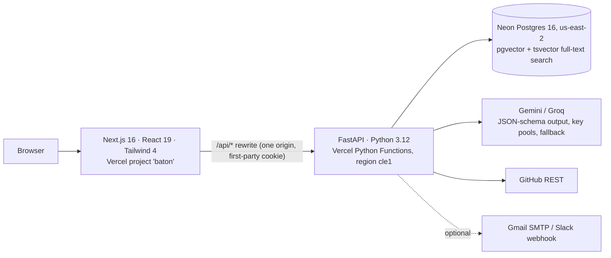

# Architecture and implementation summary (as built, Round 3)

`docs/02_ARCHITECTURE.md` is the original plan. This file describes what runs on production on 16 Nov 2026.
Every deviation from the plan is logged in `docs/DECISIONS.md`.

## 1. Shape

- **One origin.** The web app proxies `/api/*` to the API project, so the visitor cookie is first-party and there is no CORS.
- **No login (demo).** A visitor cookie owns a private sandbox copy of the demo. The persona ("Viewing as …") travels in a header and is resolved **server-side** to a member and roles. Real teams use private invite links that lock identity (D20).
- **Serverless-safe pipeline.** No workers, queues or background tasks. `pipeline.advance(run_id, ~45 s)` does a bounded slice and checkpoints. The run page's polling drives it, and a CLI loop drives it locally (D8).
- **The API runs next to the database** (`cle1`, beside Neon us-east-2), because every request opens a fresh pooled connection (D58).

## 2. Data model (Postgres, 23 tables, migrations 0001–0006)

| Area | Tables |
|---|---|
| Tenancy and people | `workspaces`, `members`, `memberships` (roles: admin, reviewer, leaver, successor, member), `visitors`, `member_invites`, `member_bindings` |
| Sources | `sources` (type, **access list**, scrub report), `chunks` (scrubbed text, location, `acl_key`, `tsv`) |
| Reconstruction | `runs`, `jobs`, `claims` (type, subject, status, review state, `superseded_by`, `stale_reason`, `derived_from`), `evidence` (quote, match score, verdict), `conflict_groups`, `claim_relations` (#2) |
| Review and handover | `review_events`, `handovers`, `handover_versions` (frozen snapshot), `acknowledgements` (#3) |
| Gap interview (#1) | `interviews`, `interview_questions` |
| Operations | `audit_events`, `llm_calls`, `notifications` |

## 3. Pipeline (`baton/pipeline.py`)

`ingest → checklist → extract → cover → match → verify → conflicts → status → handover`

1. **Ingest** (`ingest/`): GitHub (live or fixture) through one normaliser; Markdown, text, PDF and Word notes; Slack and Discord exports. Text is chunked, then **secrets are scrubbed before storage**. Each chunk inherits its source's access list.
2. **Checklist** (`reconstruct/checklist.py`): what a successor *should* know, derived from the repo: the leaver's open PRs and issues, env keys, workflows, files they mostly maintain.
3. **Extract** (`reconstruct/extractor.py`): the AI proposes typed claims with exact quotes. **Batches never mix access lists.** Responses are validated against a Pydantic schema, retried once, and otherwise fail visibly without crashing the run.
4. **Cover:** full-text search for checklist items. Uncovered ones become **Missing**.
5. **Match** (`verify/quote_match.py`): every quote must be found in its cited chunk (normalised fuzzy match ≥ 90). This is a hard gate.
6. **Verify** (`verify/entailment.py`): a separate, isolated AI call sees only the claim and the quoted span.
7. **Conflicts** (`reconstruct/conflicts.py`, `relations.py`): value-class conflicts, reversals, relation signals and stale open work. These are rules, not AI.
8. **Status** (`status.py`): a **pure function** of evidence and review state decides `verified | supported | inferred | conflicting | missing`. Duplicates are merged here, only when the access lists are identical (D57).
9. **Handover:** creates the leaver → successor handover. Nothing is shared until a reviewer approves a version.

## 4. The three Round 3 improvements

| | How it works | Where |
|---|---|---|
| **#1 Gap interview** | The reviewer builds questions from open Missing items and unresolved conflicts, then edits and sends them. The leaver answers on their own page (free text, a pick between conflicting claims, "don't know", or "ask someone else"). Each answer becomes a chunk of a `testimony` source whose access list is the **intersection** of the access lists behind the question, so testimony never widens access. The answer *is* the quote, so the quote check is exact. `status.py` labels it "Leaver testimony" and never marks it Verified without a reviewer. A conflict pick only *proposes* a resolution. **No AI on this path.** | `routers/interviews.py`, `acl.acl_intersection`, `status.py` |
| **#2 Timeline** | Pure rules classify related claims as **reversal**, **earlier state**, **contradiction** or (reviewer-only) **unrelated**, each with the deciding signal: reversal words, PR merge, dates, "previously". A replacement dated earlier than what it replaces becomes a contradiction. Open work is flagged **stale** with the reason. Reviewer overrides are audited and survive re-runs. The successor sees stale work as history and their own tasks first. **No AI on this path.** | `reconstruct/relations.py`, `ledger.rebuild_relations`, `routers/relations.py`, `DecisionTimeline.tsx` |
| **#3 Acknowledgement and re-rendering** | The successor marks items *Got it*, *Ask a question* or *Not mine*, per approved version. A response carries over if the item is unchanged and resets if it changed. Questions go to the reviewer, are answered in place (PII-masked) and are closed by the successor. Withheld items that name the successor or carry a deadline are flagged in the preview. **Rewrite** searches only chunks the successor can read; the AI gets a topic label and those passages, never the withheld wording (`assert_only_visible`, pinned by a test). The result must quote a passage, stay on topic, pass the verifier, and must not duplicate a fact the successor already sees. | `routers/acks.py`, `reconstruct/rerender.py`, `routers/rerender.py` |

## 5. Permissions (the trust core)

- `acl.py`: a claim is visible only if **every** source it cites is visible to the viewer. This is checked in queries and projections at **every read**: ledger, claim detail, search, Ask, changelog, export, notifications, acknowledgements and interviews.
- The successor's handover is projected at read time from the frozen snapshot and the *current* access lists, so tightening access later is honoured at once.
- Personal emails and phone numbers are masked for non-reviewers, and secrets never reach storage or a model.
- Tests: a 40-endpoint isolation test (another visitor gets 404), and a sweep of every GET route as the successor (0 leaks in 179 requests).

## 6. AI usage

The adapter (`baton/llm/`) uses REST with JSON-schema output, key pools (3 Gemini, 2 Groq) and provider fallback (D26). The AI is used for:
- extraction;
- the isolated verifier;
- checklist coverage;
- Ask;
- rewriting withheld items.

It is **never** used for statuses, relations, permissions or interview answers. The demo's AI outputs are computed once and frozen, so judges never wait on a cold AI call or a quota.

## 7. Testing

214 API tests on real Postgres; a citation eval against a golden ledger; 17 Playwright end-to-end and accessibility tests run against production; simulated blind-tester readiness runs. See `docs/TESTING.md`.
